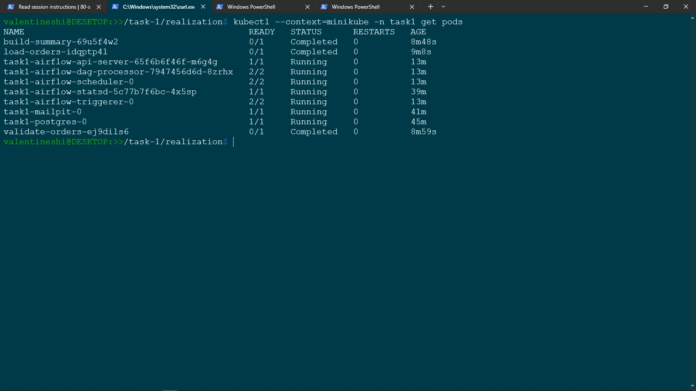
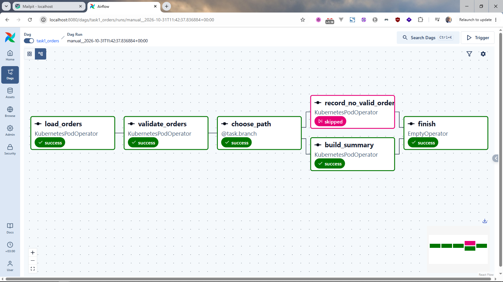
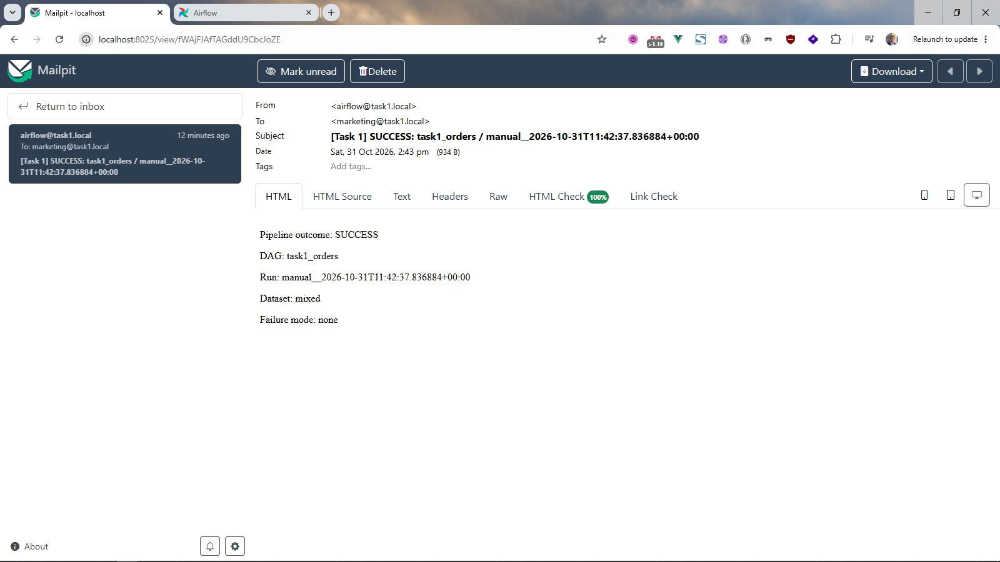
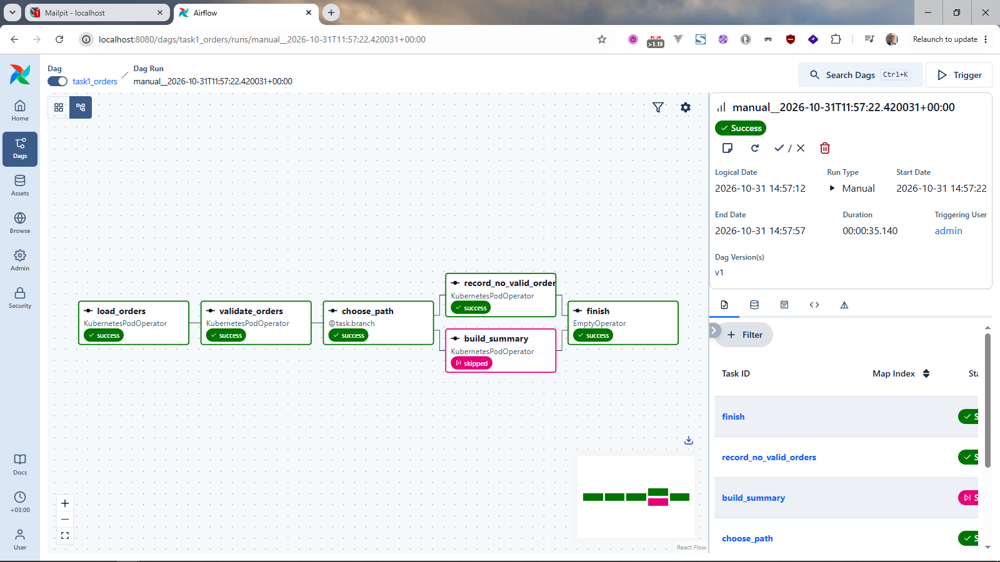
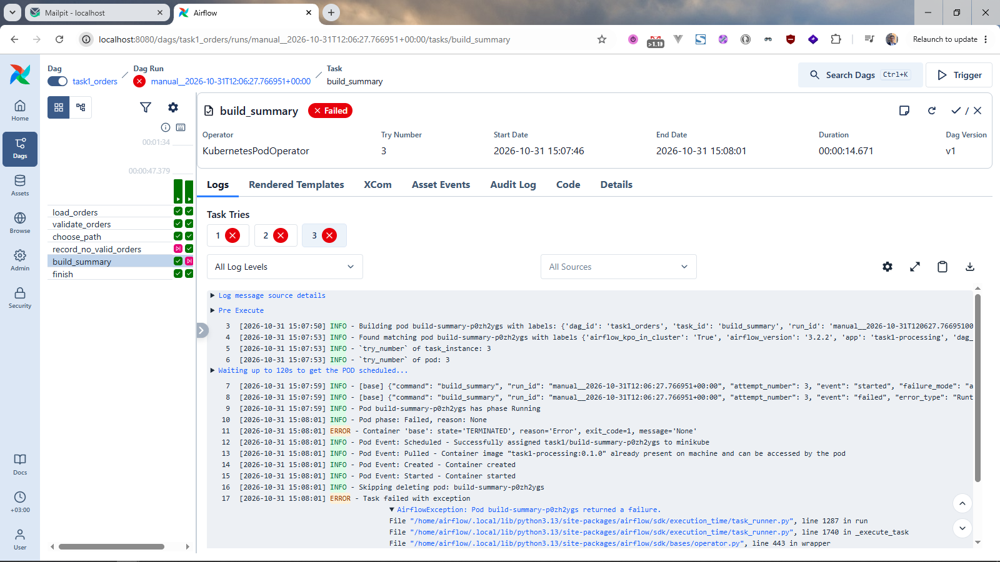
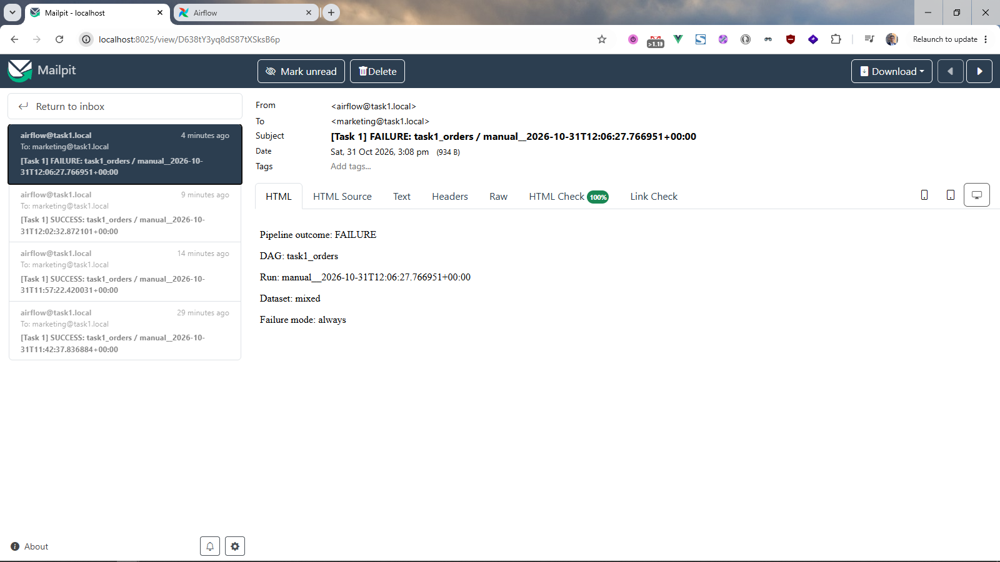

# Задание 1. Результаты POC пакетной обработки

- [Реализация и обоснование](#реализация-и-обоснование)
- [Проверенные прогоны](#проверенные-прогоны)
- [Скриншоты](#скриншоты)
  - [Локальное развёртывание](#локальное-развёртывание)
  - [Ветвь формирования сводки](#ветвь-формирования-сводки)
  - [Уведомление об успешном завершении](#уведомление-об-успешном-завершении)
  - [Ветвь отсутствия валидных заказов](#ветвь-отсутствия-валидных-заказов)
  - [Исчерпание повторных попыток](#исчерпание-повторных-попыток)
  - [Уведомление об ошибке](#уведомление-об-ошибке)

---

POC использует Apache Airflow 3.2.2, развёрнутый в Minikube с помощью официального Helm chart версии 1.22.0. Отдельные pod с Python-приложением читают синтетические заказы из PostgreSQL, проверяют их и либо формируют сводку по дням, либо фиксируют отсутствие валидных заказов. Один экземпляр PostgreSQL содержит отдельные базы исходных данных, обработки и метаданных Airflow. Mailpit принимает уведомления о завершении пайплайна.

## Реализация и обоснование

- [ADR: выбор технологического решения](task-1.adr.md).
- [Код пайплайна](code/dags/task1_orders.py): ветвление по результатам анализа данных, две повторные попытки с задержкой 15 секунд и SMTP callbacks успешного и неуспешного завершения DAG.
- [Код обработки](code/processing/app.py): чтение PostgreSQL, валидация, формирование отчётов, транзакционная запись и управляемые демонстрационные сбои.
- [Инструкции развёртывания](code/deployment/README.md), [настройка DAG](code/dags/README.md) и [демонстрационные данные](code/data/README.md). Команды с относительными путями выполняются из каталога `code/` этой папки.
- [Подробная запись результатов прогонов](code/evidence/README.md).

## Проверенные прогоны

Результаты зафиксированы по выводу SQL-запросов, подтверждениям работы Airflow и Mailpit и приведённым ниже скриншотам.

| Сценарий                     | Идентификатор запуска                      | Подтверждённый результат                                                                                                                  |
| ---------------------------- | ------------------------------------------ | ----------------------------------------------------------------------------------------------------------------------------------------- |
| Формирование сводки          | `manual__2026-10-31T11:42:37.836884+00:00` | 3 валидных и 2 отклонённых заказа; суммы сводки 150.00 и 75.00; email об успешном завершении.                                             |
| Нет валидных заказов         | `manual__2026-10-31T11:57:22.420031+00:00` | 0 валидных и 3 отклонённых заказа; ветвь формирования сводки пропущена; строки сводки отсутствуют; результат `no_valid_orders`.           |
| Восстановление после сбоя    | `manual__2026-10-31T12:02:32.872101+00:00` | После одной неуспешной попытки обработка завершилась успешно; результаты отчёта не продублированы.                                        |
| Исчерпание повторных попыток | `manual__2026-10-31T12:06:27.766951+00:00` | Три неуспешные попытки; DAG завершился с ошибкой; сводка и успешный бизнес-результат отсутствуют; получение email об ошибке подтверждено. |

## Скриншоты

### Локальное развёртывание

### Ветвь формирования сводки

### Уведомление об успешном завершении

### Ветвь отсутствия валидных заказов

### Исчерпание повторных попыток

### Уведомление об ошибке

Скриншоты кода и конфигурации, обсуждавшиеся для комплекта результатов, в этой папке пока отсутствуют.

Демонстрация подтверждает описанное поведение пайплайна на небольших детерминированных наборах данных. Производительность на миллионе записей и готовность к промышленной эксплуатации не подтверждались.
