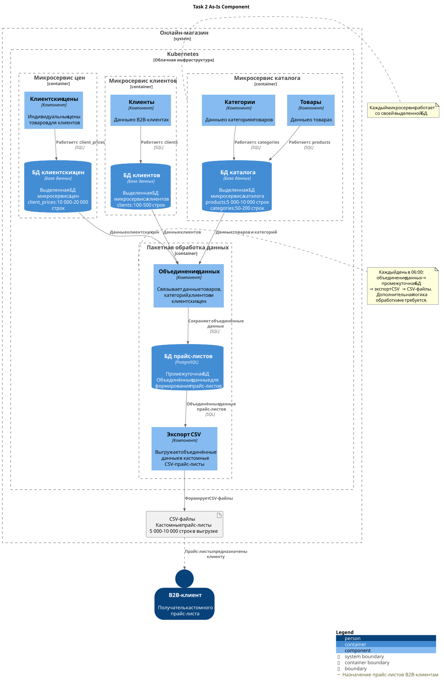

# Задание 2. Результаты разработки дизайна модуля пакетной обработки данных

Задача — ежедневно в 06:00 формировать кастомные CSV-прайс-листы для B2B-клиентов. Объём выгрузки составляет 5 000–10 000 строк; дополнительная логика обработки данных не требуется.

## Обоснование выбора технологического решения

См. [Краткий анализ технологических решений](brief-analyis.md): содержит сравнительную таблицу Spring Batch, Apache Airflow, K8s Job и Spark по предложенным критериям, их преимущества и ограничения, а также вывод о выборе решения.

Выбран **Kubernetes CronJob с небольшим приложением для объединения данных и выгрузки**. Решение использует существующий кластер Kubernetes и выполняет два последовательных этапа: объединение данных из БД микросервисов с сохранением в промежуточной БД прайс-листов, затем экспорт в CSV после успешного завершения первого этапа.

## Компонентная диаграмма As-Is

Диаграмма отражает согласованную интерпретацию исходной архитектуры. В границах микросервисов каталога, клиентов и цен показаны их компоненты и выделенные БД. Граница пакетной обработки содержит компоненты «Объединение данных» и «Экспорт CSV», а также промежуточную «БД прайс-листов» PostgreSQL.

Поток данных: БД микросервисов → объединение данных → БД прайс-листов → экспорт CSV → CSV-файлы. B2B-клиент показан как получатель прайс-листов. Диаграмма служит основанием для сравнения технологических решений.

Task 2 As-Is Component

